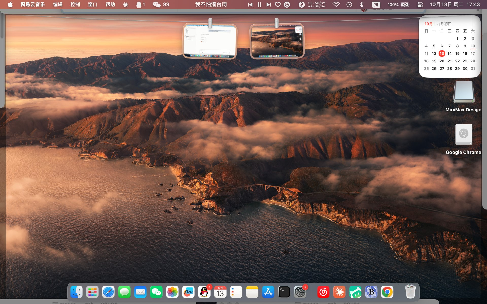
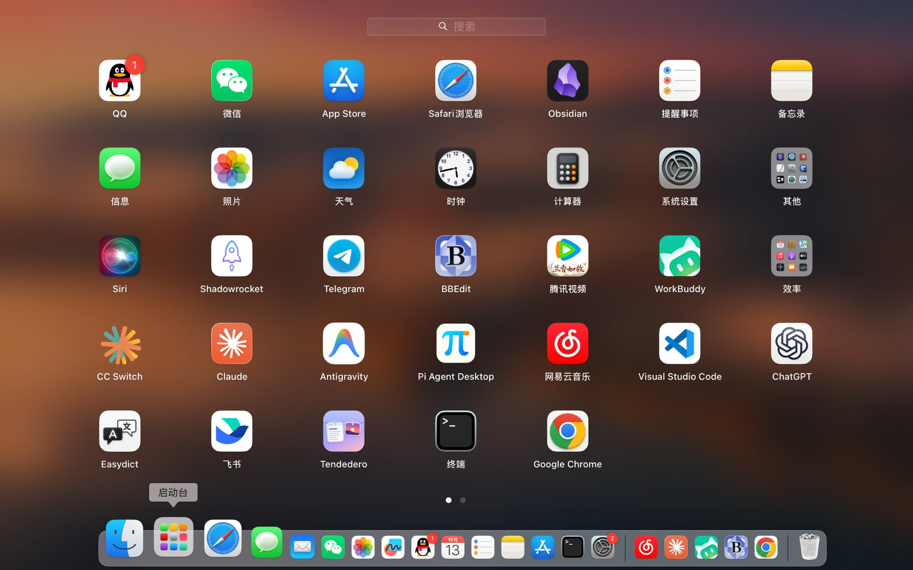

# 联想小新 Pro 13 2020（VIUU4）黑苹果 EFI

基于 **OpenCore** 的 Hackintosh EFI，适用于 **联想小新 Pro 13 2020 英特尔版（机型代号 VIUU4）**。

本仓库即本人日常在用的配置：`config.plist` 于 2026-10-10 从 ESP 分区直接提取并经 SHA256 校验（`e6a399c3…`），与在用的引导配置一致。**序列号、MLB、SystemUUID、ROM 等隐私信息已全部替换为占位符**，使用前请按下文说明生成自己的三码。

| 项目 | 值 |
|---|---|
| 引导器 | OpenCore（OpenCore.efi 构建于 2026-10-07，功能上为 1.0.0+） |
| 实测系统 | **macOS Sequoia 15.6 (24G84)** |
| SMBIOS | MacBookPro16,3 |
| 提取/校验日期 | 2026-10-10（SHA256: e6a399c350c70ebdc9bfb42498d16895cfee33bc71113a40bbeaf4e5f533e78d） |

---

## 硬件配置

| 组件 | 型号 / 参数 |
|---|---|
| 电脑型号 | 联想小新 Pro 13 2020（Lenovo VIUU4） |
| 处理器 | Intel Core i5-10210U（Comet Lake，4C/8T，1.6GHz） |
| 核显 | Intel UHD Graphics（Comet Lake，仿冒 Coffee Lake 驱动） |
| 独显 | NVIDIA GeForce MX350（已屏蔽，见 ACPI / boot-args） |
| 内存 | 16 GB 板载 DDR4-2666 |
| 硬盘 | 西部数据 WDC PC SN730 512GB（NVMe，macOS + Windows 双系统） |
| 声卡 | Realtek ALC257（AppleALC，layout 99） |
| 网卡 | Intel AX201（Wi-Fi 6，itlwm + HeliPort） |
| 蓝牙 | Intel 蓝牙（IntelBluetoothFirmware + BlueToolFixup） |
| 屏幕 | 13.3 英寸 IPS，2560×1600，100% sRGB，DC 调光 |
| 触控板 | I2C 玻璃触控板（VoodooI2C + VoodooI2CHID + VoodooInput） |
| 键盘 | 背光键盘（VoodooPS2Controller + Lenovo 定制键位映射） |
| 电池 | 56 Wh |
| SMBIOS 机型 | MacBookPro16,3 |

## 实机截图

**桌面（macOS Sequoia 15.6，Notice：菜单栏原生显示电池/Wi-Fi/蓝牙）**：



**启动台（常用 App 均正常运行）**：



---

## 目录结构

```
EFI/
├── BOOT/
│   └── BOOTX64.efi            # OpenCore 引导存根（Bootstrap）
└── OC/
    ├── OpenCore.efi
    ├── config.plist           # 已脱敏（三码为占位符）
    ├── ACPI/                  # 16 个 SSDT（15 启用，1 备用）
    ├── Kexts/                 # 28 个 kext（24 启用，4 备用）
    ├── Drivers/               # UEFI 驱动（5 启用，其余 OpenCore 自带备用）
    ├── Tools/                 # OpenCore 工具（2 启用）
    └── Resources/             # OpenCore 图形资源
```

> 原 ESP 中还有 `EFI/Microsoft`（Windows 引导管理器），属于 Windows 侧组件，本仓库未包含。

---

## ACPI 补丁

| 文件 | 状态 | 作用 |
|---|---|---|
| SSDT-OCPublic-Merge.aml | ✅ | OC 公共合并补丁（宪武 OC-Little 系列整合） |
| SSDT-PLUG-_SB.PR00.aml | ✅ | CPU 电源管理（PluginType） |
| SSDT-PMCR.aml | ✅ | PMCR 设备（Comet Lake 电源管理） |
| SSDT-RTC_Y-AWAC_N.aml | ✅ | RTC/AWAC 修复 |
| SSDT-SBUS.aml | ✅ | SBUS（SMBUS）设备修复 |
| SSDT-PNLF-CFL.aml | ✅ | 背光控制（CFL 平台，配合 -igfxblr） |
| SSDT-GPRW.aml | ✅ | 即时唤醒修复（配合 GPRW→XPRW 补丁） |
| SSDT-DeepIdle.aml | ✅ | CPU 深度空闲 |
| SSDT-NDGP_OFF-AOAC.aml | ✅ | 屏蔽 MX350 独显，服务 AOAC 现代待机 |
| SSDT-PCI0.LPCB-Wake-AOAC.aml | ✅ | LPCB 唤醒修复（AOAC） |
| SSDT-I2CxConf.aml | ✅ | I2C 触控板 GPI 配置 |
| SSDT-OCI2C-TPXX-lenovoPRO13.aml | ✅ | I2C 触控板设备（Lenovo Pro13） |
| SSDT-RMCF-PS2Map-LenovoPRO13.aml | ✅ | PS2 键盘键位映射（Lenovo 定制） |
| SSDT-ACPI-USB-XHUB-PRO13.aml | ✅ | USB 端口定制（XHUB） |
| SSDT-BAT_BST-fix.aml | ✅ | 电池状态（BST）修复 |
| SSDT-EC.aml | ⬜ 备用 | USB 电源/EC 方案；当前改用 ECEnabler.kext，故未启用 |

config.plist 中的 ACPI 重命名补丁：`PNLF→XNLF`、`_DSM→XDSM`、`GPRW→XPRW`、`_BIF→XBIF`、`H_EC→EC`。

---

## 内核扩展（Kexts）

### 已启用

| Kext | 版本 | 作用 |
|---|---|---|
| Lilu | 1.7.2 | 补丁框架（众多 kext 的依赖） |
| VirtualSMC | 1.3.7 | SMC 仿真 |
| WhateverGreen | 1.7.0 | 核显驱动/补丁 |
| AppleALC | 1.9.7 | 声卡（ALC257，alcid=99） |
| itlwm | 2.3.0 | Intel WiFi（AX201，Sequoia，需 HeliPort） |
| IntelBluetoothFirmware | 2.4.0 | Intel 蓝牙固件 |
| IntelBTPatcher | 2.4.0 | Intel 蓝牙补丁 |
| BlueToolFixup | 2.7.2 | 新版 macOS 蓝牙修复 |
| VoodooI2C (+VoodooGPIO/VoodooI2CServices/VoodooInput) | 2.9.1 | I2C 触控板核心 |
| VoodooI2CHID | 2.9.1 | I2C 触控板 HID |
| VoodooPS2Controller (+VoodooPS2Keyboard) | 2.3.7 | PS2 键盘 |
| BrightnessKeys | 1.0.4 | 亮度快捷键 |
| YogaSMC | 1.5.2 | Lenovo Yoga 机型热键支持 |
| ECEnabler | 1.0.3 | EC（嵌入式控制器）读写，替代 SSDT-EC |
| HibernationFixup | 1.4.9 | 休眠/唤醒修复（hbfx 参数见 boot-args） |
| NVMeFix | 1.1.4 | NVMe 电源管理（SN730） |
| RestrictEvents | 1.1.6 | 不受支持机型的系统更新限制绕过 |
| SMCBatteryManager | 1.3.7 | 电池信息 |
| SMCLightSensor | 1.3.7 | 环境光传感器 |
| SMCProcessor / SMCSuperIO | 1.3.7 | CPU/传感器 SMC 插件 |
| USBToolBox + UTBDefault | 1.2.0 | USB 端口定制 |
| XHCI-unsupported | 0.9.2 | XHCI 控制器支持 |
| AMFIPass | 1.4.1 | AMFI 库验证绕过 |

### 随附未启用（备用）

| Kext | 说明 |
|---|---|
| AirportItlwm 2.3.0 | Intel WiFi 的另一种方案（伪装为原生 AirPort）。当前使用 itlwm + HeliPort；如需 Apple 连续性功能可切换，但 Sequoia 上稳定性需自测 |
| IO80211FamilyLegacy / IOSkywalkFamily | 旧版 WiFi 栈，配合 AirportItlwm 使用 |
| YogaSMC 1.5.2 | 随附备用（当前 Fn 键由 BrightnessKeys + PS2 映射 + VoodooI2C 覆盖） |

> 原 `Kexts/AirportItlwm.kext.original.bak`（改机过程中的备份）已从分享副本中移除。

---

## UEFI Drivers

已启用：`OpenRuntime.efi`（必需）、`OpenCanopy.efi`（图形引导界面）、`OpenHfsPlus.efi`（HFS+ 分区支持）、`ResetNvramEntry.efi`（OpenCore 菜单内重置 NVRAM）、`ToggleSipEntry.efi`（OpenCore 菜单内开关 SIP）。

`Drivers/` 目录中还保留有 OpenCore 自带的其余驱动（ArpDxe、Http*、Virtio* 等），均未启用，可按需在 config.plist 中开启。

---

## config.plist 关键设置

### 启动参数（NVRAM → 7C436110 → boot-args）

```
debug=0x100 -v alcid=99 -igfxblr hbfx-ahbm=7 hbfx-patch-pci=XHC keepsyms=1 -vi2c-force-polling ipc_control_port_options=0 -wegnoegpu
```

| 参数 | 作用 |
|---|---|
| `debug=0x100 -v` | 啰嗦模式 + 调试输出 |
| `alcid=99` | ALC257 声卡 layout 99 |
| `-igfxblr` | 开启背光寄存器修复（WhateverGreen） |
| `hbfx-ahbm=7` | HibernationFixup AHBM 模式 |
| `hbfx-patch-pci=XHC` | HibernationFixup XHC PCI 补丁 |
| `keepsyms=1` | panic 时保留符号 |
| `-vi2c-force-polling` | VoodooI2C 强制轮询模式 |
| `ipc_control_port_options=0` | 允许旧版 IPC（老 kext 兼容） |
| `-wegnoegpu` | 不驱动 MX350 独显 |

### 核显注入（DeviceProperties → PciRoot(0x0)/Pci(0x2,0x0)）

- `AAPL,ig-platform-id` = `0x3E9B0000`，`device-id` = `0x9B3E0000`（Comet Lake 0x9B41 仿冒为 Coffee Lake 0x3E9B）
- 显存：stolenmem 19MB / fbmem 36MB / unifiedmem 2048MB
- `framebuffer-con1-type` = HDMI + LSPCON 支持，`enable-hdmi20`、背光/DPCD 修复
- `model` = `Intel UHD Graphics 630`

### CPUID 仿冒（Kernel → Emulate）

`Cpuid1Data` = `0x0806EC`（Comet Lake 0x0A0660 仿冒为 Coffee Lake 0x0806EC，解决集显驱动问题）。

### 其他关键项

| 项目 | 值 | 说明 |
|---|---|---|
| csr-active-config | `0x03080000` | SIP 部分关闭 |
| SecureBootModel | `Disabled` | 因此 **iMessage/FaceTime 不可用**（无有效三码时属正常） |
| ScanPolicy | `0` | 显示所有启动项 |
| ShowPicker / Timeout | `true` / `20s` | 显示引导菜单 |
| PickerMode | `Builtin` | 内置选择器 |
| LauncherOption | `Full` | 安装 OpenCore 启动项 |
| HibernateMode | `None` | 休眠模式 |
| UpdateSMBIOSMode | `Custom` | 自定义 SMBIOS |
| SpoofVendor / ProcessorType | `true` / `1793` | 厂商/处理器类型仿冒 |
| Kernel Patch | `Disable RTC wake scheduling` | 启用 |
| Kernel Block | `Allow IOSkywalk Downgrade`（MinKernel 23.0.0） | 防止 Sequoia 升级 WiFi 栈 |
| Misc → Entries | 1 个自定义 Windows 启动项 | **当前禁用**；其中的 GPT 分区 GUID 已替换为占位符，使用时请改回本机值 |

---

## 功能状态（2026-10-13 于本机实测）

| 功能 | 状态 | 备注 |
|---|---|---|
| 核显输出 / HDMI | ✅ | CFL 仿冒驱动，con1 走 HDMI+LSPCON |
| 声卡（扬声器/耳机） | ✅ | AppleALC 已加载，内置输入/输出设备正常枚举 |
| WiFi（AX201） | ✅ | itlwm + HeliPort，实测联网正常（en1） |
| 蓝牙 | ✅ | State: On |
| 触控板（手势/多指） | ✅ | VoodooI2C + VoodooInput |
| 键盘 / Fn 键 | ✅ | VoodooPS2 + Lenovo 键位映射 |
| 亮度调节 | ✅ | BrightnessKeys + PNLF-CFL |
| 电池信息 | ✅ | pmset 读取正常（100% / AC） |
| USB 端口 | ✅ | USBToolBox 定制 |
| NVMe（SN730） | ✅ | NVMeFix |
| 睡眠/唤醒相关 | ✅ | HibernationFixup + AOAC 补丁（HibernateMode=None） |
| MX350 独显 | 🚫 | 故意屏蔽 |
| 内置麦克风 | ⚠️ | ALC257 已知问题（小新Pro13 社区通病），建议外接带麦耳机 |
| iMessage / FaceTime | 🚫 | SecureBootModel=Disabled，属预期 |
| 隔空投送 / 接力 / 连续互通 | 🚫 | itlwm 方案不支持；切换 AirportItlwm 可获部分能力 |

---

## 使用方法

1. **BIOS 准备**：关闭 Secure Boot；按小新Pro13 社区教程解锁 DVMT / CFG Lock（刷新 BIOS 有风险，请自行评估）。
2. **备份原 ESP**：把现有 `EFI` 文件夹完整备份到 Windows 或 U 盘。
3. **挂载 ESP**：
   - macOS：`sudo diskutil mount disk0s1`（按实际分区号）
   - Windows：`diskpart` → `select disk n` → `select partition 1` → `assign letter=S`
4. **复制**：将本仓库的 `EFI` 整个复制到 ESP 根目录（如已有 OC 目录，先清空旧 OC）。
5. **生成自己的三码**（重要，否则序列号为占位符）：用 OCAT / ProperTree 打开 `config.plist`，在 `PlatformInfo → Generic` 中替换 `MLB`、`SystemSerialNumber`、`SystemUUID`、`ROM`（可用 GenSMBIOS / MacSerial 生成，建议选 MacBookPro16,3 对应机型；需要 iMessage 时另行配置）。
6. **启动**：重启按 F12 选择 OpenCore，或在 BIOS/UEFI 中添加启动项 `\EFI\OC\OpenCore.efi`。
7. **WiFi**：进入 macOS 后安装 HeliPort 并打开（itlwm 的配套管理工具），选择 AX201 连接网络。

---

## 隐私说明

分享前已抹除以下设备标识信息，替换为占位符：

| 项目 | 处理 |
|---|---|
| SystemSerialNumber（序列号） | `C02XXXXXXXXX` |
| MLB（主板序列号） | `C02XXXXXXXXXXXXXX` |
| SystemUUID | `AAAAAAAA-BBBB-CCCC-DDDD-EEEEEEEEEEEE` |
| ROM（MAC） | `11:22:33:44:55:66`（OpenCore 示例值） |
| 自定义启动项中的 GPT 分区 GUID | `XXXXXXXX-XXXX-XXXX-XXXX-XXXXXXXXXXXX` |

机型代号 **VIUU4**（联想小新 Pro 13 2020）按本人要求保留公开，用于说明适用硬件。

---

## 致谢

- [Acidanthera](https://github.com/acidanthera)：OpenCore、Lilu、VirtualSMC、WhateverGreen、AppleALC、BrightnessKeys、RestrictEvents、VoodooPS2Controller
- 宪武 的 OC-Little / P-Little hotpatch 系列 SSDT（联想系列机型）
- [zxystd/itlwm](https://github.com/OpenIntelWireless/itlwm)
- VoodooI2C（alexandred）、VoodooInput（kishorprins）、VoodooGPIO（coolstar）
- 1Revenger1（ECEnabler）、lvs1974（HibernationFixup）、org.acidanthera（NVMeFix）、dhinakg（AMFIPass、USBToolBox）、ru.joedm（SMCSuperIO）、ru.usrsse2（SMCBatteryManager/SMCLightSensor/SMCProcessor）
- [daliansky/XiaoXinPro-13-hackintosh](https://github.com/daliansky/XiaoXinPro-13-hackintosh) 及黑果小兵的小新Pro13 教程
- OpenCore 社区与所有黑果爱好者

---

## 声明

本 EFI 基于上述开源项目整理，仅供学习交流使用。硬件存在个体差异（即使是同型号），不保证直接可用；因使用本仓库内容造成的任何问题，本人不承担责任。
